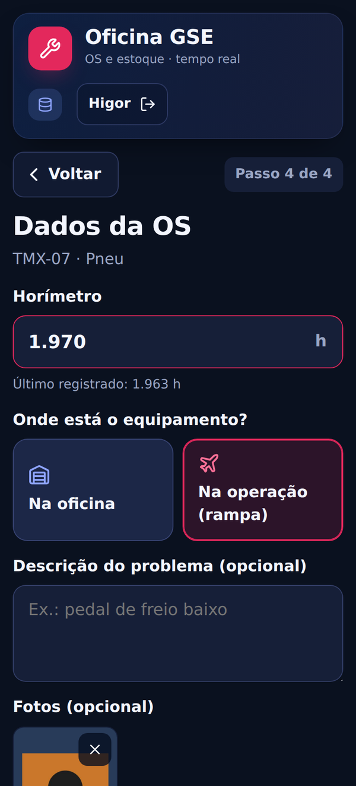
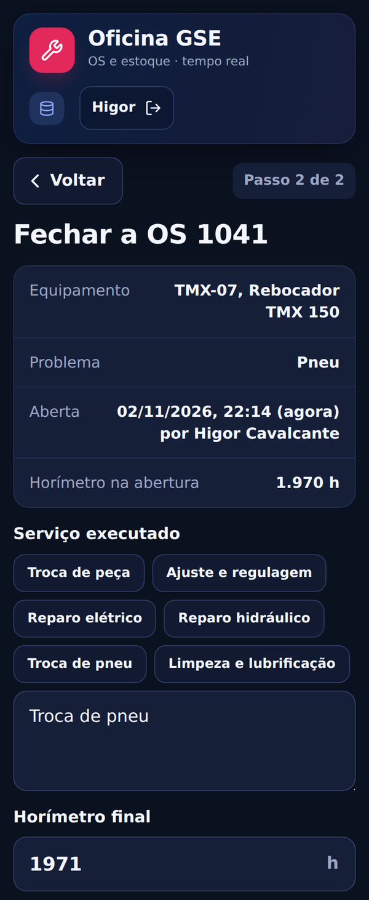
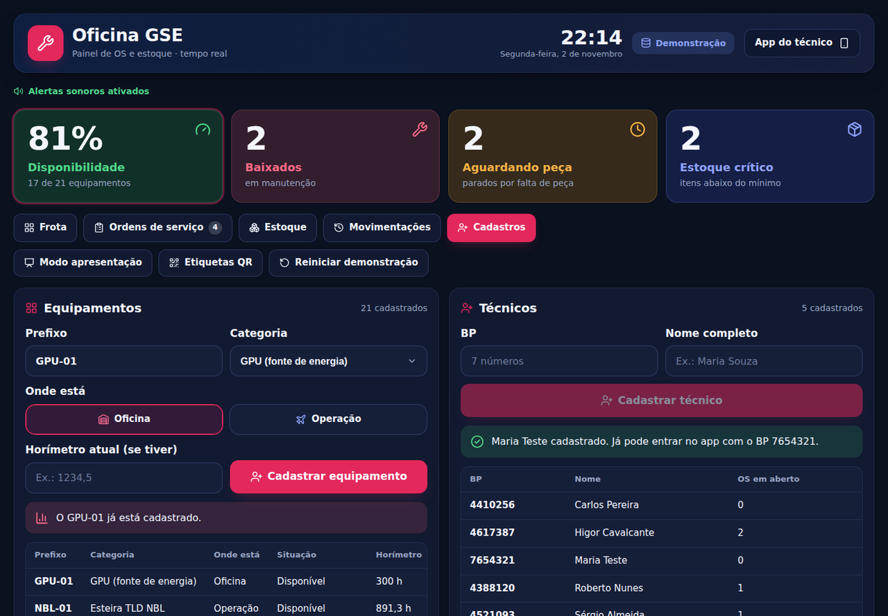

<p align="center">
  
</p>

<h1 align="center">Oficina GSE · OS e estoque</h1>

<p align="center">
  Protótipo do app de ordens de serviço e estoque da oficina GSE de Congonhas (CGH).<br />
  O técnico entra com o BP e lê QR codes para abrir a OS, retirar peças e fechar a OS.<br />
  O painel do planejamento se atualiza em tempo real.
</p>

<p align="center">
  
  
  
  
  
  
</p>

## Telas

<table>
  <tr>
    <td align="center"><br /><sub>Início e Minhas OS</sub></td>
    <td align="center"><br /><sub>Abertura: horímetro, local e fotos</sub></td>
    <td align="center"><br /><sub>Fechamento com serviço executado</sub></td>
  </tr>
</table>

<p align="center"><br /><sub>Painel do planejamento: frota em tempo real, com a localização de cada equipamento</sub></p>

<details>
<summary>Mais telas</summary>

<p align="center"><br /><sub>Entrada com o BP</sub></p>
<p align="center"><br /><sub>Leitura do QR code</sub></p>
<p align="center"><br /><sub>Ordens de serviço com detalhes e fotos</sub></p>
<p align="center"><br /><sub>Cadastro de equipamentos e técnicos</sub></p>
<p align="center"><br /><sub>Modo apresentação: celular e painel na mesma tela</sub></p>
<p align="center"><br /><sub>Etiquetas QR para imprimir</sub></p>

</details>

## Funcionalidades

O protótipo cobre a **Fase 1 (MVP: oficina e estoque)** da proposta do GSE Connect.

**App do técnico (celular)**

- **Entrada pelo BP**: só entra quem está no cadastro de técnicos.
- **Abrir OS** lendo o QR code do equipamento. O técnico escolhe o defeito (ou fala) e informa horímetro, localização (oficina ou operação), descrição e fotos. O número da OS, o técnico e a hora saem automáticos.
- **Pegar peça** lendo o QR code da prateleira, sempre vinculada a uma OS. O estoque baixa na hora, com aviso de estoque mínimo. Se a peça estiver em falta, a OS fica como “aguardando peça”. Dá para desfazer uma retirada errada.
- **Fechar OS** lendo o QR code do equipamento. O técnico registra o serviço executado (com atalhos), o horímetro final, as fotos e confere as peças usadas. O equipamento volta a ficar disponível na operação.
- **Minhas OS**: em aberto, aguardando peça e finalizadas, com os detalhes e as fotos de cada uma.

**Painel do planejamento (computador ou TV da oficina)**

- Disponibilidade da frota em tempo real, por categoria, com a localização de cada equipamento.
- Ordens de serviço com busca, filtros, tempo em atendimento, peças usadas, detalhes e fotos.
- Estoque com itens cadastrados, com saldo, abaixo do mínimo, zerados e peças mais usadas nos últimos 30 dias.
- Histórico de movimentações e alerta sonoro de OS nova.
- **Cadastros** de equipamentos (prefixo, categoria, localização e horímetro) e de técnicos (BP e nome).
- **Modo apresentação** e **etiquetas QR** prontas para imprimir.

Sem configurar o banco, tudo funciona em **modo demonstração**, com os dados guardados no navegador.

As telas do técnico foram pensadas para quem tem pouca intimidade com tecnologia: botões grandes, poucos passos, atalhos no lugar de digitação e textos curtos. Toda leitura de QR também tem uma lista de “QR de teste”, para quando não houver etiqueta por perto.

## Tecnologias

| Parte         | Escolha                                                                             |
| ------------- | ----------------------------------------------------------------------------------- |
| Interface     | React 19 + TypeScript (modo estrito), Vite 8                                        |
| Dados         | Supabase (PostgreSQL, tempo real e funções no banco) ou Firebase 12 (Firestore)     |
| Leitura de QR | [qr-scanner](https://github.com/nimiq/qr-scanner), com a câmera traseira do celular |
| Etiquetas     | [qrcode](https://github.com/soldair/node-qrcode)                                    |
| Ícones        | [Lucide](https://lucide.dev)                                                        |
| Qualidade     | ESLint, Prettier e GitHub Actions                                                   |

## Começando

Precisa do **Node.js 20.19 ou mais novo**. A versão indicada está no `.nvmrc` (22 LTS).

```bash
npm install
npm run dev
```

Abra o endereço que aparecer (normalmente http://localhost:5173). Sem a configuração do banco, o app abre em **modo demonstração**, e duas abas abertas no mesmo computador se atualizam juntas.

Para testar a entrada, use o BP **4617387** (Higor Cavalcante). Outros técnicos são cadastrados no painel, na aba **Cadastros**.

| Endereço          | Para quê                                               |
| ----------------- | ------------------------------------------------------ |
| `/#/`             | App do técnico (celular)                               |
| `/#/painel`       | Painel do planejamento (computador)                    |
| `/#/apresentacao` | Celular do técnico e painel lado a lado, para reuniões |
| `/#/etiquetas`    | Etiquetas QR para imprimir                             |

A câmera só funciona em **https** ou no **localhost**. No celular pela rede local, use os QR de teste ou publique no Firebase Hosting, que já é https.

## Ligar no Supabase

O app usa o Supabase quando as duas variáveis abaixo estão preenchidas. Se também houver dados do Firebase, o Supabase tem prioridade.

1. **Projeto:** em [supabase.com](https://supabase.com), crie (ou abra) o projeto. O protótipo usa tabelas que começam com `oficina_`, então pode dividir o projeto com outros sistemas sem misturar.
2. **Tabelas e funções:** no painel do Supabase, abra **SQL Editor > New query**, cole todo o conteúdo de [`supabase/schema.sql`](supabase/schema.sql) e clique em **Run**. Pode rodar de novo sem problema.
3. **Chaves:** clique em **Connect** (topo da tela) ou vá em **Project Settings > API**. Copie a **Project URL** e a chave **anon / publishable**. Nunca use a `service_role`.
4. **Arquivo `.env.local`**, na pasta do projeto:

   ```
   VITE_SUPABASE_URL=https://SEU-PROJETO.supabase.co
   VITE_SUPABASE_ANON_KEY=sua-chave-anon
   ```

5. **Teste:** `npm run dev`. Na primeira abertura o app grava os dados de exemplo sozinho. O selo no topo do painel mostra a conexão.
6. **Tempo real:** o `schema.sql` já liga o tempo real nas tabelas. Se algum aparelho demorar a atualizar, confira em **Database > Publications > supabase_realtime** se as tabelas `oficina_*` estão marcadas. Mesmo sem isso, o app confere o banco a cada 20 segundos.
7. **Site publicado:** nas variáveis do GitHub (_Settings > Secrets and variables > Actions > Variables_), crie `VITE_SUPABASE_URL` e `VITE_SUPABASE_ANON_KEY`. O workflow de deploy já usa as duas na hora do build.

**Como a segurança funciona hoje:** as tabelas só aceitam leitura direta. Toda gravação passa pelas funções `oficina_*` do banco, que validam as regras (estoque nunca negativo, OS fechada não reabre, horímetro final não menor que o inicial) e travam a linha enquanto gravam, então dois técnicos nunca baixam a mesma peça ao mesmo tempo. Como o protótipo ainda não tem login, quem tiver a chave do app consegue chamar essas funções, inclusive o "reiniciar". Antes de usar com dados reais, ligue o Supabase Auth e restrinja as funções por perfil.

**Tabelas:** `oficina_equipamentos`, `oficina_pecas`, `oficina_tecnicos`, `oficina_ordens`, `oficina_ordem_pecas` (peças usadas em cada OS), `oficina_fotos`, `oficina_movimentacoes` e `oficina_config` (contador da OS).

**Fotos:** ficam na tabela `oficina_fotos`, já reduzidas pelo app (JPEG de até 1024 px, até 3 na abertura e 3 no fechamento). Para produção, o ideal é mover para o Supabase Storage.

**Região:** o projeto do Supabase fica no servidor escolhido na criação. Em `us-east-1` (Virgínia) cada ação leva uns décimos de segundo a mais que em São Paulo. Para o protótipo não atrapalha.

**Plano gratuito:** o projeto pausa depois de cerca de uma semana sem uso. Para o uso diário na oficina, vale o plano pago.

## Ligar no Firebase (alternativa)

1. No console do Firebase, crie um projeto. O recomendado é um projeto separado do GSE Connect, só para o protótipo.
2. Abra **Firestore Database** e crie o banco (região sugerida: `southamerica-east1`, São Paulo).
3. Na aba **Regras**, cole o conteúdo de `firestore.rules` e publique. Se for usar o mesmo projeto do GSE Connect, leia os cuidados mais abaixo antes.
4. Em **Configurações do projeto > Seus apps**, adicione um app **Web** e copie a configuração.
5. Copie `.env.example` para `.env.local` e preencha com esses valores.
6. Rode `npm run dev` de novo. O selo no topo troca de “Demonstração” para “Conectado”.

Na primeira vez, o app grava sozinho os dados de exemplo no Firestore.

## Publicar

### Pelo computador (Firebase CLI)

```bash
npm install -g firebase-tools
firebase login
firebase hosting:sites:create oficina-gse-os   # cria o site do protótipo dentro do projeto
npm run deploy
```

Antes, troque `COLOQUE-AQUI-O-ID-DO-PROJETO` no `.firebaserc` pelo ID do projeto. Se o nome `oficina-gse-os` já estiver em uso, escolha outro e troque também o campo `"site"` no `firebase.json`.

O app fica em `https://oficina-gse-os.web.app`.

### Automático (GitHub Actions)

O workflow `Deploy no Firebase Hosting` fica desligado até ser configurado. Depois de ligado:

- cada push na `main` publica na URL do protótipo;
- cada pull request ganha um link de prévia que dura 7 dias.

Para ligar, em **Settings > Secrets and variables > Actions** do repositório:

1. Crie as **variáveis** `FIREBASE_PROJECT_ID` e `VITE_FIREBASE_API_KEY`, `VITE_FIREBASE_AUTH_DOMAIN`, `VITE_FIREBASE_PROJECT_ID`, `VITE_FIREBASE_STORAGE_BUCKET`, `VITE_FIREBASE_MESSAGING_SENDER_ID`, `VITE_FIREBASE_APP_ID`, com os mesmos valores do `.env.local`.
2. Crie o **segredo** `FIREBASE_SERVICE_ACCOUNT` com o JSON de uma conta de serviço do Google Cloud. Ela precisa dos papéis _Firebase Hosting Admin_ e _API Keys Viewer_.

O workflow `CI` roda sempre, em todo push e pull request. Ele confere o lint, a formatação e os tipos, e gera o build.

### Se for usar o mesmo projeto do GSE Connect

- O `firebase.json` aponta para o site `oficina-gse-os`, e não para o site principal. Assim, publicar o protótipo **não substitui** o gseconnect.web.app. Não apague o campo `"site"`.
- As coleções do protótipo começam com `oficina_`, para não misturar com as do GSE Connect. O prefixo pode ser trocado em `VITE_COLLECTION_PREFIX`.
- **Não publique o `firestore.rules` inteiro**, porque ele substituiria as regras do GSE Connect. Copie só o bloco `match /{colecao}/{documento} { ... }` para dentro das regras atuais.

## Dados no Firestore

Com o prefixo padrão `oficina_`:

| Coleção                 | Documento           | Campos                                                                                                                                                                                                                                 |
| ----------------------- | ------------------- | -------------------------------------------------------------------------------------------------------------------------------------------------------------------------------------------------------------------------------------- |
| `oficina_equipamentos`  | prefixo (`TMX-01`…) | `kind`, `status` (ok/down/wait), `osId`, `location` (oficina/operacao), `hourMeter`                                                                                                                                                    |
| `oficina_pecas`         | `P1`, `P2`…         | `name`, `fits`, `pn`, `loc`, `qty`, `min`                                                                                                                                                                                              |
| `oficina_ordens`        | número da OS        | `equipId`, `problem`, `description`, `location`, `tech`, `techBp`, `status` (open/wait/closed), `openedAt`, `hourMeterStart`, `closedAt`, `closedBy`, `closedByBp`, `hourMeterEnd`, `serviceDone`, `parts`, `waitPartId`, `photoCount` |
| `oficina_fotos`         | automático          | `osId`, `stage` (abertura/fechamento), `data`, `at`, `by`                                                                                                                                                                              |
| `oficina_movimentacoes` | automático          | `at`, `kind`, `text`                                                                                                                                                                                                                   |
| `oficina_tecnicos`      | BP                  | `name`                                                                                                                                                                                                                                 |
| `oficina_config`        | `contador`          | `nextOs`                                                                                                                                                                                                                               |

Abrir OS, retirar peça, desfazer, marcar como aguardando peça, fechar OS e cadastrar usam **transações**. Assim, dois técnicos nunca baixam a mesma peça ao mesmo tempo, o número da OS nunca se repete e o mesmo prefixo ou BP não é cadastrado duas vezes. No painel, **Reiniciar demonstração** grava de novo os dados de exemplo, que ficam em `src/data/seed.ts`.

**Fotos:** o app reduz cada foto para um JPEG leve (até 1024 px) e guarda na coleção `oficina_fotos`, até 3 fotos na abertura e 3 no fechamento. Assim o protótipo continua no plano gratuito do Firebase. Para produção, o ideal é mover as fotos para o Cloud Storage, que hoje exige o plano pago (Blaze).

**QR codes:** o de equipamento é `GSE:EQ:TMX-04` (também aceita só `TMX-04`), e o de prateleira é `GSE:PECA:PN-10021` (também aceita só o P/N). Equipamentos cadastrados no painel ganham etiqueta automaticamente.

## Estrutura

```
src/
  main.tsx, App.tsx      entrada e rotas
  data/                  createStore, supabaseStore, firebaseStore, localStore, seed, regras de negócio
  tech/                  entrada com o BP e telas do técnico
  panel/                 painel do planejamento
  present/               modo apresentação
  labels/                etiquetas QR
  components/            cabeçalho, câmera e leitor de QR, cartão de OS, botões e selos
  lib/                   datas e textos, leitura do QR, alerta sonoro, rotas
  styles.css             visual no mesmo modelo do GSE Connect
supabase/
  schema.sql             tabelas, permissões, funções e tempo real do banco (rode no SQL Editor)
```

## Scripts

| Comando           | O que faz                                           |
| ----------------- | --------------------------------------------------- |
| `npm run dev`     | Servidor local para desenvolver                     |
| `npm run build`   | Confere os tipos e gera a pasta `dist`              |
| `npm run preview` | Serve a pasta `dist`                                |
| `npm run check`   | Lint, formatação e tipos (o mesmo que o CI confere) |
| `npm run format`  | Formata o código com o Prettier                     |
| `npm run deploy`  | Build e publicação no Firebase Hosting              |

## Próximos passos

Antes de usar com dados reais:

- [ ] Login de verdade (Supabase Auth ou o login corporativo aprovado) e permissões por perfil no banco. Hoje a chave do app basta para gravar.
- [ ] Perfis de acesso: técnico, almoxarifado, planejamento e operação de rampa.
- [ ] Fotos no Supabase Storage (ou Cloud Storage) em vez de dentro do banco.
- [ ] Reconhecimento de voz de verdade no “Outro: falar o problema”.

Já previsto na proposta para as próximas fases:

- [ ] Fase 2: cadastro completo do estoque, entrada e ajuste de materiais, histórico completo dos equipamentos, indicadores (MTTR, MTBF, consumo) e relatórios.
- [ ] Fase 3: checklists da rampa, ocorrências, controle do ATIV e integração com o Sofit.

## Contribuindo

O fluxo de branches, commits e pull requests está em [CONTRIBUTING.md](CONTRIBUTING.md), e o histórico de versões, em [CHANGELOG.md](CHANGELOG.md).

<sub>Uso interno da oficina GSE.</sub>
